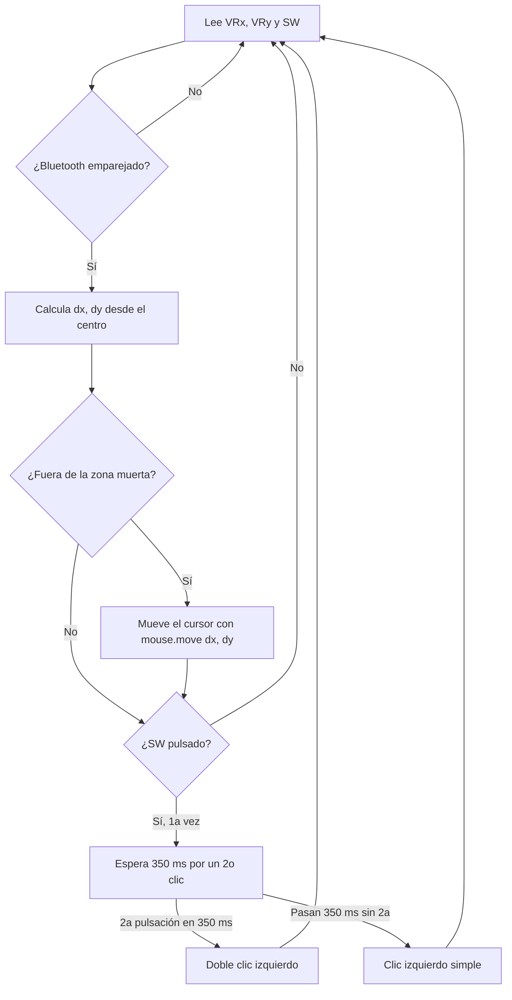

# 🖱️🎮 TikTok · Mouse Bluetooth con un ESP32 + Joystick


> **Mini proyecto en donde el ESP32 se convierte en mouse Bluetooth, controlado por un joystick.**
> Mueve el cursor, hace clic izquierdo y doble clic izquierdo — sin cables, sin instalar nada en la PC.

---

## ✨ ¿Qué hace?

Con un solo joystick controlas el mouse de tu computadora en **Windows, macOS, Linux o Android**, como si fuera un mouse inalámbrico normal.

| Movimiento del joystick | Acción en la computadora |
| :--- | :--- |
| ↔️ **Mover a los lados** | 🖱️ Mover el cursor a la izquierda / derecha |
| ↕️ **Mover arriba / abajo** | 🖱️ Mover el cursor arriba / abajo |
| 👇 **1 pulsación corta** | 👆 Clic izquierdo |
| 👇👇 **2 pulsaciones rápidas** | 👆👆 Doble clic izquierdo |
| ❌ **Clic derecho** | **No existe por ahora** |

Mientras más empujas el joystick, más rápido se mueve el cursor: de 1 a 12 píxeles por reporte. Si lo sueltas, el cursor se queda quieto.

El ESP32 se anuncia por Bluetooth como **`ESP32-WROOM-Mouse`** y la computadora lo ve como un mouse inalámbrico normal. No necesitas drivers, ni una app, ni un receptor USB.

---

## 🧰 Materiales

| Cant. | Componente |
| :---: | :--- |
| 1 | ESP32-WROOM-32 · **DevKit V1 de 30 pines** (DOIT) |
| 1 | Joystick analógico de 2 ejes + botón (módulo KY-023 o similar) |
| 5 | Cables Dupont hembra-hembra |
| 1 | Cable USB (Micro-USB o USB-C, según tu placa) para alimentar y programar |
| 1 | Computadora con Bluetooth (Windows 10 / 11, macOS, Linux o Android) |

> ⚡ **El joystick va a 3.3 V, NO a 5 V.** El ADC del ESP32 es de 3.3 V y con 5 V leerías valores fuera de rango.

---

## 🔌 Diagrama de conexión

### Tabla de conexiones

| Joystick | ESP32 DevKit V1 | GPIO | Función |
| :--- | :--- | :---: | :--- |
| `VCC` | `3V3` | — | Alimentación 3.3 V |
| `GND` | `GND` | — | Tierra común |
| `VRx` | `D32` | **GPIO 32** | Eje X · izquierda / derecha · ADC1 |
| `VRy` | `D33` | **GPIO 33** | Eje Y · arriba / abajo · ADC1 |
| `SW` | `D4` | **GPIO 4** | Botón · a GND al pulsar · pull-up interno |

### Esquema

```
                    ESP32-WROOM-32
                 DevKit V1 · 30 pines
                ┌─────────────────────┐
                │                     │
   JOYSTICK     │  3V3  ────────────► │ VCC
   ┌────────┐   │                     │
   │        │   │  GND  ────────────► │ GND
   │  VRx ──┼───┼──► D32 (GPIO 32)    │
   │  VRy ──┼───┼──► D33 (GPIO 33)    │
   │  SW  ──┼───┼──► D4  (GPIO 4)     │
   │  VCC ──┼───┘                     │
   │  GND ──┼───┐                     │
   └────────┘   │                     │
                └─────────────────────┘

        VCC = 3.3 V   ·   GND = común
        VRx / VRy = analógico 0-4095
        SW = digital, LOW al pulsar
```

### ¿Por qué GPIO 32 y 33?

Son **ADC1** (canales 4 y 5). El ADC2 deja de funcionar cuando el WiFi/Bluetooth está activo, así que con ADC1 el joystick sigue leyendo bien mientras el ESP32 está conectado por Bluetooth. GPIO 4 es un pin digital seguro para el botón, con `INPUT_PULLUP` interno, así no necesitas resistencia externa.

> 🔁 **Si el cursor se mueve al revés:** es por la orientación del módulo del joystick. Solo cambia el signo de ese eje en el código, no muevas los cables.

---

## 🧠 ¿Cómo funciona el ESP32 como mouse Bluetooth?

Este es el corazón del proyecto. No es magia, son 3 ideas juntas:

### 1. El ESP32 se hace pasar por un mouse HID

La computadora no ve un "ESP32", ve un **dispositivo HID (Human Interface Device)** por Bluetooth Low Energy (BLE), igual que un mouse inalámbrico de tienda.

```
ESP32 ──(BLE, perfil HID)──► PC / celular
        "Soy un mouse"
              │
              ▼
   La PC mueve el cursor y hace clic
   como si viniera de un mouse real
```

El perfil HID de mouse manda 3 cosas en cada reporte: cuánto se movió el cursor en X, cuánto en Y, y qué botones están pulsados. Por eso funciona en el escritorio, en el navegador y en cualquier programa, sin instalar nada.

### 2. El joystick se lee como un voltaje

El joystick es en realidad dos potenciómetros (uno por eje) + un botón.

- En el centro, cada eje lee **~2048** (la mitad de 0-4095, ADC de 12 bits).
- Al empujar a la derecha, `VRx` sube hacia 4095. A la izquierda, baja hacia 0.
- Al empujar arriba, `VRy` baja hacia 0. Abajo, sube hacia 4095.
- Al pulsar, `SW` pasa de HIGH a **LOW** (GND).

El código usa una **zona muerta** para que el cursor no se mueva solo cuando sueltas el joystick:

```
0 ──────── 1798 ──────── 2298 ──────── 4095
  ▲ Se mueve   │  Centro, quieto   │  ▲ Se mueve
```

Y la velocidad es proporcional: cerca del centro se mueve a 1 píxel por reporte, al tope a 12 píxeles por reporte. Así puedes apuntar fino y también cruzar la pantalla rápido.



### 3. Clic simple vs doble clic

Hay un detalle importante en el código:

- El clic simple **espera 350 ms** para ver si viene una segunda pulsación. Si llega, es un **doble clic** y no se manda el simple.
- Si pasan los 350 ms y no llegó nada, entonces sí se manda el **clic simple**.

Por eso el clic simple tiene un mini retraso de 350 ms. Es normal, es para que no te haga un clic simple y luego un doble clic encima.

El clic derecho **no existe por ahora**: el código solo usa `MouseButton::Left`, nunca `MouseButton::Right`.

---

## ⚠️ PRIMERO: instala estas 2 librerías (en este orden)

> **Este es el paso que hace que funcione.** Sin estas librerías, el proyecto no compila.

### 1️⃣ NimBLE-Arduino

1. En Arduino IDE: **Sketch > Incluir librería > Administrar bibliotecas...**
2. Busca: `NimBLE-Arduino`
3. Autor: **h2zero**
4. Versión: **2.3.8 o mayor**
5. Dale a **Instalar**.

### 2️⃣ HijelHID_BLEMouse

1. En la misma ventana de **Administrar bibliotecas...**
2. Busca: `HijelHID_BLEMouse`
3. Autor: **hijelhub**
4. Dale a **Instalar**.

### ❌ ¿Por qué NO la librería clásica de T-vK?

La librería clásica **"ESP32 BLE Mouse" de T-vK** es la que sale primero en el buscador, pero **NO compila con el core ESP32 3.3.12**, igual que pasaba con su librería de teclado: usa `std::string` donde el core 3.x ya espera `String`, y falla dentro de la librería misma, no en tu código.

**HijelHID_BLEMouse está hecha para el core 3.x y usa NimBLE**, por eso es la que funcionó al final. Es la librería hermana de `HijelHID_BLEKeyboard`, la del proyecto del teclado multimedia.

---

## 💻 Instalación y carga del código

### Requisitos

- **Arduino IDE 2.x**
- **Core ESP32 3.3.12** instalado *(Herramientas > Placa > Gestor de tarjetas > busca `esp32` de Espressif)*
- Las 2 librerías de arriba, en ese orden

### Configuración de la placa

| Ajuste | Valor |
| :--- | :--- |
| Placa | **DOIT ESP32 DEVKIT V1** o **ESP32 Dev Module** |
| Puerto | El puerto COM / USB de tu ESP32 |
| Upload Speed | 921600 *(o 115200 si te falla la carga)* |

### Pasos

1. Clona o descarga este repositorio.
2. Abre `mouse_bluetooth_joystick_wroom32/mouse_bluetooth_joystick_wroom32.ino` en Arduino IDE.
3. Conecta el ESP32 por USB y selecciona su puerto.
4. Dale a **Subir** (flecha →).
5. Abre el Monitor Serie a **115200 baudios**. Debe decir:

```
Mouse BLE listo. Busca 'ESP32-WROOM-Mouse' en Bluetooth.
```

---

## 📲 Emparejar con la computadora

### Windows 11

1. Presiona **Win + I** para abrir Configuración.
2. Ve a **Bluetooth y dispositivos** y prende el Bluetooth.
3. Dale a **Agregar dispositivo > Bluetooth**.
4. Espera y elige **`ESP32-WROOM-Mouse`**.
5. Dale a **Conectar**. No pide PIN.

### Windows 10

Configuración > Dispositivos > Bluetooth y otros dispositivos > Agregar Bluetooth u otro dispositivo > Bluetooth > `ESP32-WROOM-Mouse`.

### Android / macOS / Linux

Ajustes / Preferencias > Bluetooth > buscar dispositivos > `ESP32-WROOM-Mouse` > Emparejar.

> 💡 El ESP32 solo acepta **una conexión BLE a la vez**. Si no aparece en la PC, revisa que no siga conectado a tu celular.

> ✅ **Lo que funcionó en la primera prueba:** el código se subió sin errores y Windows lo detectó como `ESP32-WROOM-Mouse, Conectado, 100%`, pero el cursor no se movía. La solución fue **desconectar y volver a conectar el Bluetooth** en Windows: Bluetooth y dispositivos > ESP32-WROOM-Mouse > Desconectar, y luego Conectar de nuevo. Después de eso el cursor ya se movió con el joystick.

---

## 💾 Código

El código completo está en [`mouse_bluetooth_joystick_wroom32/mouse_bluetooth_joystick_wroom32.ino`](mouse_bluetooth_joystick_wroom32/mouse_bluetooth_joystick_wroom32.ino).

```cpp
#include <HijelHID_BLEMouse.h>

HijelBLEMouse mouse("ESP32-WROOM-Mouse", "Crucito", 100);

const uint8_t PIN_VRX = 32;  // eje X: izquierda / derecha
const uint8_t PIN_VRY = 33;  // eje Y: arriba / abajo
const uint8_t PIN_SW  = 4;   // pulsar joystick = clic izquierdo

const int CENTRO = 2048;
const int ZONA_MUERTA = 250;   // 1798 a 2298 = quieto
const int VELOCIDAD_MIN = 1;
const int VELOCIDAD_MAX = 12;
const unsigned long DOBLE_CLIC_MS = 350;

unsigned long primerClicTiempo = 0;
bool clicPendiente = false;
bool swAntes = false;
unsigned long ultimoCambioSW = 0;

int calcularVelocidad(int valor) {
  int distancia = valor - CENTRO;
  if (abs(distancia) <= ZONA_MUERTA) return 0;
  int magnitud = map(abs(distancia), ZONA_MUERTA, CENTRO,
                     VELOCIDAD_MIN, VELOCIDAD_MAX);
  magnitud = constrain(magnitud, VELOCIDAD_MIN, VELOCIDAD_MAX);
  return (distancia > 0) ? magnitud : -magnitud;
}

void setup() {
  Serial.begin(115200);
  pinMode(PIN_SW, INPUT_PULLUP);
  analogReadResolution(12); // 0-4095
  mouse.begin();
  Serial.println("Mouse BLE listo. Busca 'ESP32-WROOM-Mouse' en Bluetooth.");
}

void loop() {
  if (!mouse.isPaired()) { delay(200); return; }

  int x = analogRead(PIN_VRX);
  int y = analogRead(PIN_VRY);
  bool sw = (digitalRead(PIN_SW) == LOW);
  unsigned long ahora = millis();

  // Mover el cursor
  int dx = calcularVelocidad(x);
  int dy = -calcularVelocidad(y); // arriba = Y negativo en pantalla
  if (dx != 0 || dy != 0) mouse.move(dx, dy);

  // Clic / doble clic izquierdo, solo al presionar
  if (sw != swAntes && ahora - ultimoCambioSW >= 50) {
    ultimoCambioSW = ahora;
    if (sw) {
      if (clicPendiente && ahora - primerClicTiempo <= DOBLE_CLIC_MS) {
        mouse.doubleClick(MouseButton::Left);
        clicPendiente = false;
      } else {
        primerClicTiempo = ahora;
        clicPendiente = true;
      }
    }
    swAntes = sw;
  }

  // Si pasó el tiempo de doble clic, fue un clic simple
  if (clicPendiente && ahora - primerClicTiempo > DOBLE_CLIC_MS) {
    mouse.click(MouseButton::Left);
    clicPendiente = false;
  }

  delay(15);
}
```

---

## 🛠️ Solución de problemas

| Problema | Causa probable | Solución |
| :--- | :--- | :--- |
| `HijelHID_BLEMouse.h: No such file or directory` | Falta la librería | Instala **primero** NimBLE-Arduino **2.3.8 o mayor**, luego **HijelHID_BLEMouse** |
| Error `std::string` en `BleMouse.cpp` | Librería T-vK vieja con core 3.3.12 | **No uses T-vK.** Usa el código de este repo, con `HijelHID_BLEMouse.h` |
| Se conecta y aparece 100%, pero el cursor no se mueve | Windows quedó conectado pero no emparejado del todo | **Desconecta y vuelve a conectar** el Bluetooth en Windows, como en la primera prueba |
| No aparece `ESP32-WROOM-Mouse` en Bluetooth | Ya está conectado a otro dispositivo | Desconéctalo del celular, presiona RST en el ESP32 y busca de nuevo |
| El cursor se mueve solo | Centro del joystick no está en 2048 | Revisa la zona muerta (250) o calibra tu joystick en el Monitor Serie |
| El cursor se mueve al revés | Orientación del módulo | Cambia el signo de ese eje en `mouse.move(dx, dy)` |
| El clic simple tarda un poco | Es normal | Espera 350 ms para ver si viene un segundo clic y hacerlo doble |

---

## 🚀 Ideas para ampliarlo

- [ ] Agregar **clic derecho** con un botón aparte (por ahora no existe)
- [ ] Agregar **scroll** con un segundo joystick o con el eje Y al mantener pulsado SW
- [ ] Poner un **OLED** que muestre si está conectado y la velocidad
- [ ] Usar el joystick como **mouse + teclado a la vez** (mover + teclas multimedia)
- [ ] Alimentarlo con batería LiPo + TP4056 para hacerlo portátil

---

## 👤 Autor

**Ivan Cruz** — [@ingiavanbeto](https://github.com/ingiavanbeto)

Proyecto hermano de [Tik-Tok-Teclado-bluetooth-con-un-esp32-Joystick](https://github.com/ingiavanbeto/Tik-Tok-Teclado-bluetooth-con-un-esp32-Joystick): mismo ESP32, mismo joystick, ahora como mouse.

Si te sirvió, dale ⭐ al repo y compártelo.

---

### 📄 Licencia

MIT — úsalo, modifícalo y compártelo libremente, solo conserva el crédito al autor.
